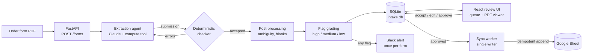

# Intake

Intake turns order form PDFs into accounting-ready line items. Claude reads each form and maps every priced
line to a product in a known SKU catalog. A deterministic checker rejects any amount or date that isn't
grounded in the document, and anything still uncertain goes to a review queue instead of being guessed.
Approved forms land in a Google Sheet exactly once.


<!-- Demo GIF placeholder: record the queue -> form -> click a value -> edit -> approve flow and save it as docs/demo.gif -->

## The problem

SaaS order forms carry the facts revenue accounting needs: which products were sold, at what price, over
which dates, billed how often. They arrive as PDFs in every layout, and someone types them into a
spreadsheet by hand. An LLM can read them, but for accounting a confident wrong number is worse than no
number. So the system has to say when it isn't sure, show where each value came from, and let a person clear
the doubtful ones quickly.

## Architecture



Without credentials every outside service has a local stand-in, so the whole thing runs with no setup:
uploads replay recorded model runs (no API key), approved rows go to `data/sheet.csv`, and alerts go to
`data/slack_outbox.jsonl`. Set the variables in `.env.example` and the same code calls Claude, the Sheets
API and a Slack webhook instead.

## The ground rule: don't pretend to know

This output feeds accounting, so a confident wrong value is worse than an honest "not sure". The one
rule the whole project is built on: **the output must never look like it knows something it doesn't.**
In practice that means:

- **Only catalog items.** The model picks from the SKU list; it can't invent items. Anything the form
  says isn't sold (e.g. services delivered by a partner) stays out.
- **Every amount has to be in the document.** An amount is rejected unless it's printed in the PDF or
  is the result of arithmetic on printed numbers, done through a `compute` tool rather than in the
  model's head.
- **Every date has to be in the document too.** A date must be printed in the PDF in some format, or be
  calculated from a printed date (e.g. end date = start date + term), with the calculation recorded next
  to it and re-checked. Otherwise the model is sent back to look again.
- **Ambiguity is shown, not resolved by guessing.** When the document supports more than one reading,
  the field is either left empty with the candidate readings listed, or given with `ambiguous: true`
  and the alternatives right next to the value. Nothing downstream can read that field without also
  seeing the doubt.
- **"Likely" is not "known".** A reading only gets ruled out if it contradicts something else in the
  document. If one reading is just more plausible, that's recorded as a hint, and the field stays
  flagged.
- **Missing stays missing, and says so.** If a field isn't in the document, it's left empty. I didn't
  fill it with the most common value from the ground truth, even where that would have scored better.
  If an important field is empty (a total, quantity, currency, service date, effective date or
  signature date), the form is marked `needs_review` and the field gets a note saying why it's empty.
- **Every value comes with the quote it was read from**, so anyone can check it.

## How the checker works

The model never gets the final word. Every submission goes through `ofparser/validator.py`, plain code with
no LLM, and is sent back until it passes (up to 3 submissions):

- **Every amount must be in the document.** It is accepted only if it's printed in the PDF (in any number
  format: `1,234.56`, `1.234,56`, `1 234,56`, `1'234.56`) or is the result of the `compute` tool on printed
  numbers. Arithmetic in the model's head doesn't count.
- **Every date must be in the document**, in any format, or be a calculation from a printed date (e.g. start
  + 12 months - 1 day) that is recorded next to it and re-checked.
- **Every SKU must be in the catalog.** If a printed name fits two SKUs about equally, the item has to be
  flagged as ambiguous, or the model has to quote the text that decides it.
- **The numbers must add up.** Quantity x unit price must divide the line total into whole billing periods,
  the period length must be sensible, and the items must add up to the printed grand total. The model can
  override one of these warnings only with a written reason.
- **Blanks need a reason.** An empty total, quantity, currency, service date, effective date or signature
  date sends the model back to look again. If it's still empty, the form is marked `needs_review` with the
  reason on the field.

What the checker can't settle becomes a flag in the review queue:

| Severity | What it means | Examples |
|---|---|---|
| high | The value can't be used as is. Approval is blocked until a reviewer accepts or edits it. | Effective date `06/04/2024` with nothing to settle day/month order; a SKU tied between two products; a checker issue still open after the last submission |
| medium | A value was given, with a recorded doubt next to it. | One price for exactly 12 months: "one-time" or "yearly"? A date kept although it isn't printed |
| low | Worth a glance. | A date calculated from a printed one; a scanned PDF whose amounts couldn't be checked against text |

## Results

### Eval gate

Every pull request runs the eval set: the 50 synthetic forms plus the real redacted form, which has a
different layout and its own catalog. A threshold miss fails the build (see "Evals in CI" below).

<!-- eval-table:start -->
| Metric | Result | Gate |
|---|---|---|
| Line-item recall | 100% | ≥ 100% |
| Wrong values (amounts, dates, billing terms) | 0 | ≤ 0 |
| Wrong SKU matches | 0 | ≤ 0 |
| Forms needing no review | 49 / 51 | ≥ 47 |
| Cost per form | $0.171 | ≤ $0.25 |
| Time per form | 28 s | - |

Not counted as wrong: 29 values flagged ambiguous with the alternative shown, 0 left blank. Generated from `evals/report.json` (51 forms, replay mode).
<!-- eval-table:end -->

**Cost per form:** about $0.17 with the 21-SKU catalog inline, as recorded in v0.8. The shared prompt cache
added in v0.11 saves about $0.05 of that on every form after the first. A 2,000-SKU catalog searched through
`search_catalog` costs about $0.20. Typical forms take 20-40 seconds.

### Field accuracy on the 50 synthetic forms

Measured on the 50 synthetic order forms in `synthetic_order_form_dataset_50/` (`runs/v0.8`, $8.40 total, about
30 seconds per form). All 50 passed the checker on the first try. One form (of-0032, below) is marked
`needs_review` because its effective date is ambiguous.

**Finding the right items:** 132 of 132 contract items found, no extra items. That includes 20 forms
where a catalog item that isn't sold has a very similar name to one that is.

**Fields**, per item (132 items, 50 forms for the header fields). Each answer lands in exactly one
column, so nothing flagged is counted in the "correct" column:

| Field | Answered, correct | Answered, flagged ambiguous | Left empty (ambiguous) | Wrong |
|---|---|---|---|---|
| Currency, total, quantity, unit price | 132 | - | - | - |
| Service start / end date | 132 | - | - | - |
| Payment terms | 132 | - | - | - |
| Invoicing frequency | 104 | 28 | - | - |
| Effective date | 49 | - | 1 | - |
| Buyer / seller signature dates | 50 | - | - | - |
| Invoicing schedule type | - | - | - | 132 (left empty, not in the documents) |
| Special notes | - | - | - | 132 (doesn't match the ground truth) |

What's behind the flagged and empty cells:

- **Invoicing frequency (28 flagged):** these items have one price covering exactly 12 months. That's
  one invoice, but "one-time" and "yearly" both describe it, and nothing in the document settles which.
  The output says "one-time" and flags "yearly" as the alternative. The ground truth says "one-time" for
  19 of them and "yearly" for 9, so the dataset itself doesn't agree on a single rule. If you only
  count a flagged answer as right when it matches the ground truth, frequency is 93.2%.
- **Effective date (1 empty):** one form prints `06/04/2024` and nothing else in it tells you whether
  that's June 4 or April 6. The parser leaves it empty and notes June 4 as the likely reading, since the
  form was signed June 7. June 4 is the right answer, but we don't count it, because the output didn't
  commit to it. That's 98% if you count the empty one as wrong.
- **Invoicing schedule type:** the forms never say whether billing is upfront, recurring, hybrid etc.;
  the ground truth has values anyway. The parser leaves it empty rather than guess.
- **Special notes:** the parser picks up the form's "Up to Customer Employee Size" line, the same kind
  of note as the real example form's ("Up to 25,000 employee size"). The ground truth has unrelated phrases
  that aren't tied to anything in the form.

A real order form is covered below, under "Testing the decisions on a real form".

### Read the 100%s with care

- **There's no held-out set.** I developed on these same 50 forms, so these numbers are optimistic.
- **The forms all come from one template** with a clean text layer. Getting amounts and dates right on
  that is a much easier test than real order forms from different vendors.
- **Some fixes came from looking at failures on this data.** Each one is written up in `CHANGELOG.md`
  with the reason it's general. The main ones:
  - Using a printed Qty column even where a SKU's parsing instruction said to leave quantity empty (v0.3,
    see "Decisions I made"). It also happened to match the ground truth, which is worth saying since it
    was a judgement call.
  - Flagging the one-time/yearly case as ambiguous (v0.3). This *lowered* the score at the time, from
    90.2% to 78.8%, because a guess that was right some of the time became an honest flag.
  - Testing each reading of a date like `12/09/2022` against the rest of the document before calling it
    ambiguous (v0.6).

The full breakdown with every failure is in `runs/v0.8/eval.md`.

## Review workflow

**Queue (`/`).** Forms waiting for review, sorted by their highest open flag, then oldest first, with
severity chips and sync status. You can filter by needs review, approved or sync failed, or upload PDFs.

**Form (`/forms/:id`).** Line items and order-form fields on the left, the PDF on the right. Each flag's reason
is shown under its row. Clicking any value jumps the viewer to its page and highlights the quote it was read
from, found in the pdf.js text layer. A flagged row can be **accepted** or **edited** inline. Numbers have
to stay numbers and dates have to be ISO dates. Editing quantity or unit price recomputes the line amount
(the line keeps its number of billing periods), and the arithmetic and grand-total checks re-run on the new
values. **Approve** stays disabled while any high flag is open; "Accept all low/medium" clears the rest in
one click. Keyboard: `j`/`k` move between flagged rows, `a` accepts, `e` edits.

**Sheets sync, exactly once.** Approval queues a sync of one row per line item. Each row's idempotency key is a
sha256 over canonical JSON (sorted keys, no whitespace, numbers as fixed decimals, strings trimmed) of the
PDF's hash, the line index and the final values. Re-approving the same form gives the same keys, while a
deliberate edit gives a new one. The sync:

1. records every key as `pending` in `sync_log`,
2. reads column A of the sheet once,
3. appends only the pending keys not already there, in one call,
4. marks appended keys and keys already present `done`. The second case covers "the append landed, then
   we crashed",
5. retries 429, 5xx and timeouts with jittered exponential backoff (1 s base, x2, 5 attempts, 30 s cap),
   re-reading column A each time, because the failed attempt may have landed. Any other 4xx fails at once
   and shows a "sync failed" badge with a retry button.

The read-then-append is safe because only one worker writes to the sheet. That assumption is documented in
`server/sheets.py`. The tests use a mocked client to cover a lost response after a successful append, 429
twice then success, crash recovery and double approval, and none of them duplicates a row.

**Slack.** A form that finishes extraction with any flag sends one Block Kit message: 🔴 if any flag is high,
🟡 otherwise, with counts per severity, up to three high-severity reasons and a "Review form" button.
`alert_sent` is recorded in `events` and checked first, so re-running extraction never alerts twice. Slack
runs on the background worker, so an outage is logged and never holds up the queue.
`python -m server.daily_summary --send` posts an optional daily summary: forms processed, flagged, approved,
and the median time from upload to approval.

## Evals in CI

`evals/run.py` scores line-item recall, wrong values (amounts, dates and billing terms answered
confidently but wrong), wrong SKU matches, forms needing no review, cost per form and time per form. The
thresholds are in `evals/thresholds.yaml`. When one fails, the runner exits non-zero and names the forms and
fields that regressed against `evals/baseline.json`.

- **Replay mode (every PR, `ci.yml`).** The model's recorded tool calls (`evals/cassettes/`, one per form) go
  through the current checker, post-processing and matcher. It needs no API key, is deterministic and
  takes about a second. It catches any regression in the non-LLM code: a recorded answer the current
  checker would reject comes out `needs_review`, and a broken parsing rule shows up as wrong values. Breaking
  one frequency rule, for example, fails the build with 22 wrong values, each named by form, item and field.
- **Live mode (local).** `python evals/run.py --mode live` runs the real API over the set (about $9);
  `--record` also refreshes the cassettes. This is the only way to test a prompt or model change. It
  isn't wired into CI, so prompt changes are checked by hand before merging.

**Branch protection.** In the GitHub repo, go to Settings → Branches → Add branch ruleset (or "Add rule" under
classic protection) for `main`:

1. Branch name pattern: `main`
2. Tick **Require a pull request before merging**
3. Tick **Require status checks to pass** and **Require branches to be up to date before merging**
4. Search for and add both checks: **`tests and evals (replay)`** and **`web e2e`**. They only appear
   in the search after the workflow has run once, so push a branch or open a PR first.
5. Optionally tick **Do not allow bypassing the above settings**, then save.

## Setup

Needs Python 3.9+, Node 20+, poppler (`brew install poppler` or `apt install poppler-utils`, for
`pdftotext`).

```bash
make setup     # Python venv + requirements, web dependencies, Playwright's Chromium
make dev       # API on :8000, review UI on http://localhost:5173, 12 recorded forms seeded
```

To use real services, copy `.env.example` to `.env` and fill in what you need. Each one is optional:

| Variable | Without it | With it |
|---|---|---|
| `ANTHROPIC_API_KEY` | uploads replay recorded runs (the 50 synthetic forms) | any PDF is extracted live |
| `GOOGLE_SERVICE_ACCOUNT_JSON`, `SHEET_ID` | rows go to `data/sheet.csv` | rows go to the Google Sheet (share it with the service account) |
| `SLACK_WEBHOOK_URL` | alerts go to `data/slack_outbox.jsonl` | alerts post to Slack |
| `REVIEW_UI_BASE_URL` | `http://localhost:5173` | link used by the Slack button |

Other commands:

```bash
make test      # unit, checker, sync, Slack and API tests (no API calls)
make eval      # replay eval gate; python evals/readme_table.py refreshes the table above
make e2e       # Playwright: upload, edit, approve, highlight

# the extractor on its own, without the review app
.venv/bin/python parse.py --catalog synthetic_order_form_dataset_50/sku_catalog.json path/to/form.pdf
.venv/bin/python eval.py runs/mine          # detailed field accuracy for a parse.py run
.venv/bin/python replay.py runs/mine        # re-check a saved run with the current checker

# long-document test case: build the PDFs, run them, report recall and correctness
.venv/bin/pip install -r requirements-dev.txt && .venv/bin/python scripts/make_long_doc.py
.venv/bin/python parse.py --catalog edge_cases/example_order_form_redacted/catalog.json \
    edge_cases/long_document/generated/*.pdf --out runs/long
.venv/bin/python scripts/long_doc_report.py runs/long
```

## Known limitations

- **No held-out set.** The extractor was developed on the same 50 synthetic forms it's evaluated on, and they
  share one template with a clean text layer. Only the one real form shows the parser working on a different
  layout. Real forms from many vendors would be a harder test.
- **Replay evals can't see prompt or model changes.** They replay recorded responses. Live evals are manual
  and cost about $9 per run.
- **The Google Sheets and Slack integrations are tested against mocked clients**, not yet against a live
  sheet or workspace.
- **Single writer.** Exactly-once sync relies on one sync worker. Running several app processes against one
  sheet would need a lock or a server-side dedupe.
- **Replay mode only knows the recorded forms.** Without an API key, a new PDF fails extraction and shows
  up in the queue with that error.
- **Click-to-highlight needs a text layer.** For scanned PDFs the viewer shows the page but can't mark the
  quote, and long scanned PDFs can't be outlined.
- **Invoicing schedule type and special notes** aren't graded: the synthetic forms don't state the first,
  and the ground truth for the second isn't tied to anything in the documents.

## Decisions I made

The code was written with Claude Code, but the decisions below were mine. Most came from looking at
the failures in a run and deciding what the right behaviour was, not just what would score better.

**Only general fixes.** Every change had to make sense for order forms in general, not only for this
template. No headings, labels or sentences from the synthetic PDFs appear in the code or prompts, and
nothing is filled in from patterns in the ground truth. If a fix only worked because of how these 50
forms happen to look, it didn't go in.

**No hallucination, even at the cost of accuracy.** For accounting data, a wrong value that looks right
is the worst possible outcome. The system never fills a field just to score better, and where something
can't be read from the document, the output says so plainly. That's why invoicing schedule type stays
at 0%: the forms don't state it, so the parser doesn't guess.

**A printed quantity overrides the catalog's "leave it null" rule.** After the first run, 4 quantities
were wrong. The catalog's instruction for that SKU said to record a quantity only when minimum and
maximum monthly hours are given, and otherwise leave it null. It didn't cover forms that simply print
a Qty column. A null quantity also breaks the invoicing frequency calculation, which needs quantity x
unit price. So I decided that a quantity printed in the document counts as stated, and the catalog's
null rule only applies when the document gives none.

**Two kinds of ambiguity, handled differently.**
- When the document could mean different things (`06/04/2024` could be June 4 or April 6), the field
  is left empty. The possible readings are listed, and the likelier one is marked if the context
  favours it.
- When the facts are clear but more than one label describes them correctly (a single price for a
  12-month term is both "one-time" and "yearly"), the value is given and flagged ambiguous, with the
  other correct option next to it.

In both cases the accountant sees the options right away instead of working them out from the PDF.

**Auditing for cases the dataset doesn't cover.** Once all the tests were passing, I asked for a review
of the whole codebase, aimed at inputs these 50 forms don't contain. It turned up four problems, all
fixed:
- **The grader forgave 1-cent errors** on money fields. Amounts now have to match exactly, to the cent.
  Re-scoring the earlier runs showed no reported result had been inflated by it.
- **The checker let blank values through without raising anything.** Now a blank important field sends
  the model back to look for it in the document. If it's still blank, the form is flagged for review
  with a note on that field saying why. Fields that are blank by design (schedule type, special notes)
  aren't flagged, so a review flag always means something.
- **European and other number formats would have been rejected.** The checker only understood
  `1,234.56`, so a form written as `1.234,56`, `1 234,56` or `1'234.56` would have had every amount
  treated as "not in the document". It now recognises all of these.
- **Scanned PDFs weren't supported.** A PDF with no text layer would have failed every check. Now it's
  detected: the model reads the page images instead, and the output carries a note that the amounts
  couldn't be checked against the document text.

## Testing the decisions on a real form

`edge_cases/example_order_form_redacted/` is a real (redacted) order form with a different layout and a different 5-SKU
catalog. I ran it with no code changes (`runs/example`, $0.32). The 3 expected items were found and
nothing else, and every amount, date, schedule type and frequency matches the expected answer.

| On the real form | Decision behind it |
|---|---|
| Worked on a new layout and catalog with no changes | Only general fixes |
| Services delivered by a partner were left out | Only items the form actually sells |
| Redacted customer name left empty, not guessed | No hallucination |
| No effective date printed: the model was sent back to look, confirmed it's not there, and the form is marked for review | Blank checker |
| "Invoices are sent Annually" was used as the frequency | Stated billing wins |

Two small differences: payment terms are quoted in full ("Net 55 from the date of the invoice" vs
"Net 55"), and a note printed once at the top of the form ("Up to Customer Employee Size: 25,000") went
on all 3 items instead of just the platform licence.

## Long documents

The forms above are a few pages. Real contracts can bury the order form in hundreds of pages of legal terms,
and sending all of it doesn't work: a 1,000-page PDF is about 4 million tokens, over the API's 600-page limit,
and would cost around $25 per turn even if it fit.

So for anything over 30 pages, the agent doesn't get the document up front. It gets a short outline built by
plain code (headings and page numbers, about 30 lines for 1,000 pages), with hints on which pages look like
prices or signatures. It reads the pages it needs with `read_pages` and can search the whole text with
`search_document`. The checker still checks every amount and date against the full document, so seeing only
some pages never weakens it.

To test it, I generated long contracts with decoy pages (a price list of optional services using catalog
product names, SLA tables, date-heavy logs, a table of contents) and buried the real form inside. One
version splits the form apart, with the term, pricing, invoicing and signatures hundreds of pages from each
other, and adds an amendment that changes a price.

| Document | Pages it read | Found every page it needed | Cost | Items correct |
|---|---|---|---|---|
| 1,000 pages, form in the middle | 7 | yes | $0.46 | yes |
| 1,000 pages, form at the start / end | 11 / 9 | yes | $0.68 / $0.54 | yes |
| 200 / 500 pages | 7 / 15 | yes | $0.46 / $0.74 | yes |
| 1,000 pages, form scattered + amendment | 12 | yes (5 of 5) | $0.72 | yes, with the amended price |

The optional products on the decoy price list were left out every time. Caveats: one run per document, and
the documents are generated, so real long contracts may be laid out in ways the outline handles less well.
Long scanned PDFs can't be outlined yet. Details are in `CHANGELOG.md` (v0.9, v0.10) and
`edge_cases/long_document/`.

## Large catalogs

Catalogs up to 200 SKUs go into the prompt; above that, the agent looks products up with a `search_catalog`
tool that tolerates abbreviations, OCR errors and typos, and returns the closest SKUs plus their look-alikes.
Tested on a generated 2,000-SKU catalog (the real 21 plus editions, add-ons, regional and near-name variants):
both ways got every SKU right on the forms tried. Caching keeps the full catalog affordable inline at 2,000 SKUs
(the first form pays to cache its 230K tokens, about $1.65, and later forms cost about $0.35 each), but at
roughly 115 tokens per SKU a catalog of 5,000-10,000+ SKUs no longer fits in the model's context at all.
Retrieval is what scales past that, and at 2,000 SKUs it already cost about the same as the 21-SKU setup
($0.20 vs $0.17 per form). One form, of-0044, came out differently from earlier runs: its effective date
"03/01/2024" was left blank as ambiguous (with March 1 as likely, which is correct) where earlier runs answered
it; both readings fit the document, so this is run-to-run variation, not the catalog. Details in `CHANGELOG.md`
(v0.11) and `edge_cases/big_catalog/`.

## Output

Each form gives an `order_form` block (parties, effective date, signature dates, grand total) and a
list of `contract_items` with their billing fields (`sku_code.value` is the catalog SKU).
Every value also carries the quote from the document it came from, under `evidence`. Trimmed
example:

```json
{
  "order_form": {
    "customer_name": "Summit Telecom",
    "effective_date": "2025-08-04",
    "contract_signed_date_buying_company": "2025-08-08",
    "contract_signed_date_selling_company": "2025-08-11",
    "grand_total": 120721.04
  },
  "contract_items_count": 1,
  "contract_items": [
    {
      "name": "Talent Intelligence Platform Premium Edition (Add-on)",
      "sku_code": {
        "value": "TALENT_INTELLIGENCE_PLATFORM_PREMIUM_ADDON",
        "ambiguous": false,
        "alternatives": [],
        "reason": null
      },
      "currency": "USD",
      "total_listed_value": 120721.04,
      "quantity": 1.0,
      "unit_price": 30180.26,
      "unit_price_period": "quarter",
      "service_start_date": "2025-08-07",
      "service_end_date": "2026-08-06",
      "invoicing_frequency": {
        "value": "quarterly",
        "source": "inferred_from_pricing",
        "ambiguous": false,
        "alternatives": []
      },
      "payment_terms": "Net 55",
      "special_notes": "Up to Customer Employee Size: 2,500"
    }
  ]
}
```

When a field is ambiguous it's either left empty with the candidate readings listed under
`ambiguous_fields`, or, for invoicing frequency and the SKU, given with `ambiguous: true` and the
alternatives next to it (a contract item always needs a SKU, so the likelier one is kept and the form is
marked `needs_review`). An empty important field also gets an entry in `missing_fields` saying why (ambiguous, or
not found, with the model's reason if it gave one), and a calculated date shows its calculation under
`inferred_dates`. Either way the output never looks more certain than it is.

## Code map

The flow for one PDF:

```
PDF -> text layer + the PDF itself -> agent loop -> checker -> post-processing -> JSON
                                          ^            |
                                          +-- errors --+
```

- **`parse.py`**: the command line. Loads the catalog, runs forms in parallel, writes the outputs.
- **`ofparser/pdf.py`**: pulls the text layer with `pdftotext -layout` (keeps table columns lined up).
  If there's no text layer (a scan), it says so, and the model reads the page images instead.
- **`ofparser/prompts.py`**: the system prompt. The whole catalog goes in, including each SKU's
  parsing instructions, along with the rules: only extract items that are in the catalog, keep out
  anything the form says isn't sold, and flag real ambiguity instead of guessing.
- **`ofparser/agent.py`**: the agent loop. The model gets the PDF and its text, and has two tools:
  - `compute`: exact decimal arithmetic, so totals like "3 years x 255,000" aren't done in the model's head.
  - `submit_extraction`: hands in the answer. It gets checked, and if it fails the model gets the
    list of problems and tries again, up to 3 submissions. If it still fails, the output is returned
    with `needs_review: true`.
- **`ofparser/validator.py`**: the checker. Two kinds of issues:
  - Errors the model must fix: an amount that doesn't appear in the document and isn't a `compute`
    result from document numbers, a SKU that isn't in the catalog, invalid or reversed dates.
  - Warnings the model must fix or explain: unit price x quantity doesn't divide evenly into the
    total, an odd billing period length, items not adding up to the grand total, a required value
    left empty, a date that isn't printed in the document and isn't a checked calculation from one.
- **`ofparser/postprocess.py`**: turns the accepted submission into the final output. The main job is
  invoicing frequency: use it if the document states it, otherwise infer it from how the price
  is split (e.g. four quarterly prices -> quarterly), and mark it ambiguous when two labels fit. It also
  notes every empty important field and sets `needs_review` for it.
- **`ofparser/pages.py`**: only for documents over 30 pages. Scores each page, builds the outline the agent
  starts from, and serves the `search_document` and `read_pages` tools.
- **`ofparser/catalog.py`**: loads the catalog and, for catalogs over 200 SKUs, serves the `search_catalog`
  tool.
- **`ofparser/schema.py`**: the output structure (Pydantic models).
- **`ofparser/compute.py`**: the arithmetic behind the `compute` tool.
- **`eval.py`**: scores a run against the ground truth. It matches items by SKU, compares fields
  exactly, and reports ambiguous answers separately so they don't inflate the main numbers.
- **`replay.py`**: runs a saved run's transcripts through the current checker, to see what a code
  change would flag without paying for a new run.
- **`ofparser/cassette.py`**: records a run's tool calls and replays them through the current code (used by the
  eval gate and the no-key demo).
- **`server/`**: the review backend. `app.py` is the API, `forms.py` holds review state, edits and the approval
  gate, `flags.py` grades the parser's doubts, `sheets.py` and `idempotency.py` do the exactly-once sync,
  `slack.py` sends alerts, and `worker.py` runs extraction threads plus the single sync/alert worker.
- **`web/`**: the review UI (Vite, React, TypeScript, Tailwind, react-pdf). `FormPage.tsx` is the two-pane
  review, `PdfViewer.tsx` and `highlight.ts` do click-to-highlight, and `e2e/` holds the Playwright tests.
- **`evals/`**: the eval gate. `run.py`, `thresholds.yaml`, `baseline.json` and `cassettes/`.
